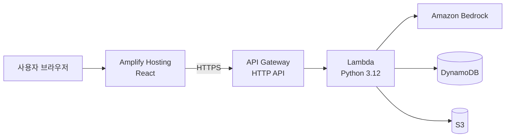

# [서비스 이름]

> 2026 전남·광주 AI 기반 지역사회 문제해결톤 (전남대학교 SW중심대학사업단) · 팀 [팀명]

[한 줄 소개 — `.kiro/steering/product.md`의 한 줄 요약과 같게]

| 배포 URL | 데모 영상 (3분) | 발표자료 |
|---|---|---|
| [링크] | [YouTube / Google Drive] | [PDF] |

## 1. 서비스 개요

### 해결하는 문제

[누가, 무엇 때문에 곤란한가. 근거 한 줄]

### 해결 방법

[우리 서비스가 그 문제를 어떻게 푸는가]

### 핵심 기능

- [기능 1]
- [기능 2]
- [기능 3]

## 2. AWS 아키텍처



| 서비스 | 쓰는 이유 |
|---|---|
| Lambda | [ ] |
| Bedrock | [ ] |
| S3 | [ ] |
| DynamoDB | [ ] |
| Amplify Hosting | [ ] |

## 3. 실행 방법

### 사전 준비

- Python 3.12, Node.js 20, AWS CLI, AWS SAM CLI
- `aws configure`로 자격 증명 설정 (키를 파일에 쓰지 않는다)
- `.env.example`을 `.env`로 복사해 값 채우기

### 로컬 실행

```bash
# 백엔드 테스트
pip install -r backend/requirements.txt pytest
PYTHONPATH=backend/src pytest -q backend/tests

# 프론트엔드
cd frontend
npm install
npm run dev
```

### 배포

```bash
cd infra
sam build && sam deploy        # 출력된 API URL을 VITE_API_URL에 넣는다
```

프론트엔드는 Amplify Hosting이 `main` 브랜치 push마다 자동 배포한다.

## 4. Kiro 활용

| 기능 | 어떻게 썼나 | 근거 |
|---|---|---|
| Specs | 기능마다 requirements → design → tasks를 생성한 뒤 tasks 순서로 구현 | [`.kiro/specs/`](.kiro/specs/) |
| Steering | 제품 정의·기술 규칙·파일 배치 규칙을 모든 대화에 자동 주입 | [`.kiro/steering/`](.kiro/steering/) |
| Hooks | 턴 종료 시 구조 검사, 파일 쓰기 전 비밀값 차단 | [`.kiro/hooks/`](.kiro/hooks/) |
| 대화 기록 | 주요 의사결정·버그 해결 과정 | [`docs/kiro-log/`](docs/kiro-log/) |

## 5. 폴더 구조

```
frontend/   React (Vite) 웹 화면
backend/    Lambda 함수 — handlers / services / ai
infra/      SAM 템플릿
.kiro/      Kiro specs · steering · hooks
docs/       팀 체크리스트, Kiro 대화 기록
scripts/    구조 검사 스크립트
```

## 6. 팀

| 이름 | 역할 | 담당 |
|---|---|---|
| 임혜량 | 팀장 · PM · 발표 | 기획, spec 검토, 발표 |
| | 프론트엔드 | `frontend/` |
| | 백엔드 | `backend/src/handlers`, `services` |
| | AI | `backend/src/ai`, Bedrock 프롬프트 |
| | 인프라 · QA | `infra/`, 배포, 데모 영상 |
