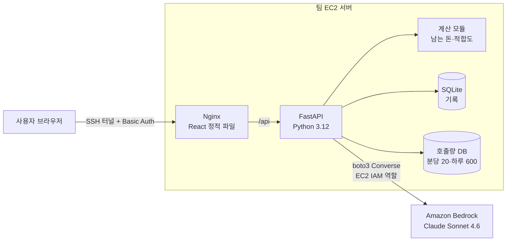

# Pridge (프릿지) · 남으면, 남는다

> 2026 전남·광주 AI 기반 지역사회 문제해결톤 (전남대학교 SW중심대학사업단) · 5조 키로로 · TOPIC 13 광주 AI 인재와 전남 기업 프로젝트 매칭 

광주·전남 사회초년생에게 연봉이 아닌 "통장에 남는 돈"을 보여 준다.
자기소개 한 줄을 AI가 읽고 분석해서 맞는 전남 프로젝트를 고르고, 월세·교통비·지원금을 뺀 실제 저축액을 서울의 같은 일 공고와 비교한다.

| 시연 | 발표자료 |
|---|---|
| 팀 서버 (SSH 터널 · 운영진 안내) | [PDF] |

## 1. 서비스 개요

### 해결하는 문제

- 채용 사이트는 명목 연봉만 보여 줘서 서울이 늘 높아 보이고, 전남 프로젝트는 비교도 해 보기 전에 후보에서 빠진다
- 월세(원룸 중앙값 강남구 약 69만원, 나주시 약 35만원, 국토교통부 실거래가)·교통비·청년 월세 지원금을 뺀 "남는 돈"을 계산해 주는 곳은 찾기 어렵다
- 2025년 연간 인구 순유출률은 광주가 제주와 함께 전국 최상위권이었다 (국가데이터처 국내인구이동통계)

### 해결 방법

| 핵심 기능 | 설명 |
|---|---|
| ① 자기소개 → 추천 3곳 | 자기소개 한 줄을 AI가 읽어서 기술·확장 기술·조건(거주·차량·근무 형태)을 채우고, 코드가 적합도(기술 80점 + 조건 20점)로 광주·전남 공고 12곳 중 상위 3곳을 고른다. AI가 실패하면 키워드로 대체 |
| ② 남는 돈 비교와 AI 분석 | 같은 일을 하는 서울(강남구·중구) 공고와 같은 공식으로 월 남는 돈·손익분기·역전 지원금·누적 저축을 계산하고, 버튼을 누르면 AI가 맞는 점·아쉬운 점·판단을 3줄로 해석 |
| ③ 1~3순위 준비 로드맵 | 담은 회사(최대 3곳)의 2년·5년 누적 저축과 부족한 기술을 보여 주고, AI가 부족한 기술을 채울 포트폴리오 프로젝트를 제안 |
| 추가: 인재 PR | 기업이 둘러보는 광주·전남 인재 소개 카드 (샘플은 가상 인물) |

금액은 AI가 아니라 코드가 계산하므로 같은 입력이면 항상 같은 결과가 나온다. 공고·월세·교통비·지원 제도는 공개 자료(고용24, 국토교통부 실거래가 등)이고, 화면에는 회사명을 가려서 보여 준다. 실제 채용 결정, 개인정보, 기업 후기 수집은 하지 않는다. 계산 기준과 출처는 [`docs/calc-criteria.md`](docs/calc-criteria.md)에 있다.

## 2. AWS 아키텍처



| 서비스 | 쓰는 이유 |
|---|---|
| Amazon EC2 + IAM 역할 | 팀 서버. 액세스 키 없이 IAM 역할로 Bedrock을 호출한다 |
| Amazon Bedrock | 자기소개 해석, 맞는 점·아쉬운 점 분석, 준비 로드맵 생성 (Claude Sonnet 4.6) |

## 3. 실행 방법

### 사전 준비

- Python 3.12, Node.js 24.x (`py -3.12 --version`, `node --version`)
- AWS 키는 필요 없다. 로컬 AI는 mock 응답이고, 실제 AI는 팀 서버에서만 호출한다

### 로컬 실행 (Windows PowerShell, 저장소 최상위 폴더)

```powershell
.\scripts\setup-local.ps1      # 최초 1회: backend/.venv, frontend/node_modules 설치
.\scripts\dev-backend.ps1      # 창 A: http://127.0.0.1:8000  (mock AI)
.\scripts\dev-frontend.ps1     # 창 B: http://127.0.0.1:5173
```

`scripts/verify-template.ps1`은 운영진 원본 해시 검사용이다. 이 저장소는 원본을 수정했으므로 실패하는 것이 정상이다.

### 테스트

```powershell
cd backend; .\.venv\Scripts\python.exe -m pytest -q
cd ..\frontend; npm.cmd run build
```

### 배포 (통합 담당자 1명)

```powershell
.\scripts\deploy.ps1 -ServerHost <팀 서버 IP> -KeyPath $HOME\<팀 PEM> -Mode Check
.\scripts\deploy.ps1 -ServerHost <팀 서버 IP> -KeyPath $HOME\<팀 PEM> -Mode Deploy
```

PEM은 프로젝트 밖에 둔다. 배포 묶음에는 `backend/app`, `frontend/src`, `frontend/public`, `.kiro/steering`, `.kiro/specs`만 들어간다.

## 4. Kiro 활용

| 기능 | 어떻게 썼나 | 근거 |
|---|---|---|
| Specs | 기능마다 requirements → design → tasks를 만들고 tasks 순서로 구현, 서버 실제 Bedrock 검증 결과는 verification.md (자기소개 해석 지시문 테스트 입력 10개 검증) | [`.kiro/specs/`](.kiro/specs/) |
| Steering | 운영진 공통 규칙 5개 + 팀의 제품 정의(`product.md`: 남는 돈 컨셉·계산 원칙·AI 제약)·파일 배치 규칙(`file-rules.md`) | [`.kiro/steering/`](.kiro/steering/) |
| Hooks | 턴 종료 시 구조 검사, 파일 쓰기 전 비밀값 차단 | [`.kiro/hooks/`](.kiro/hooks/) |
| 대화 기록 | 주요 의사결정·버그 해결 과정 | [`docs/kiro-log/`](docs/kiro-log/) |

## 5. 폴더 구조

```
backend/app/team/   남는 돈 계산·적합도 추천·AI 지시문과 파싱·로드맵·인재 PR API (나머지 backend/app은 운영진 공통)
frontend/src/       React 화면 (pages: 화면, components: 조각, lib: API·계산 보조)
.kiro/              specs · steering · hooks
docs/               팀 체크리스트, 계산 기준, 피치, Kiro 대화 기록, 운영진 스타터 원본 README
scripts/            실행·배포 스크립트(운영진) + 구조 검사
ops/                운영진 서버 도구 (수정하지 않음)
```

## 6. 팀 (5조 키로로)

| 이름 | 역할 | 담당 |
|---|---|---|
| 한지수 | 팀장 · 통합 · 배포 · 발표 | 코드 통합, 서버 Check · Deploy, 발표 |
| 신희수 | 화면 | 프론트엔드 화면 설계·구현 |
| 김민서 | AI · 검증 | AI 지시문, 테스트 입력, 서버 실제 응답 검증 |
| 이지언 | 문서 · 시연 | 문서, 시연 준비 |
| 임혜량 | 백엔드 · 데이터 | 입력 검증, 필요한 저장 구조, 예외 처리  |

공통 스타터: 전남대학교 Kirothon 공통 스타터 r2 (운영진 제공, 원본 설명은 [`docs/STARTER.md`](docs/STARTER.md))
