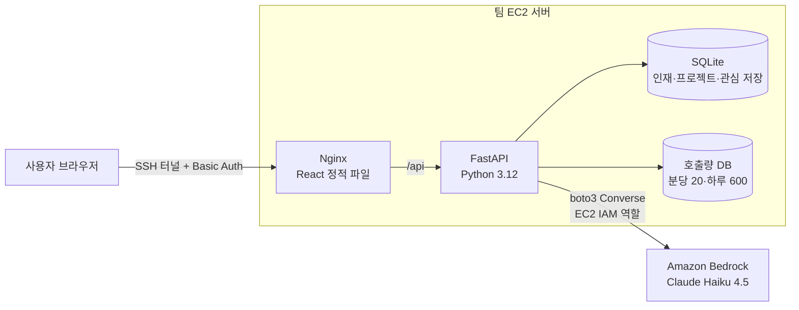

# [서비스 이름]

> 2026 전남·광주 AI 기반 지역사회 문제해결톤 (전남대학교 SW중심대학사업단) · 5조 키로로 · TOPIC 13 광주 AI 인재와 전남 기업 프로젝트 매칭 

전남 기업이 막연하게 적은 "AI로 이런 걸 하고 싶다"를 학생 팀이 할 수 있는 프로젝트 범위로 정리하고,
기술이 맞는 광주 AI 인재를 추천 이유와 함께 연결한다.

| 시연 | 데모 영상 (3분) | 발표자료 |
|---|---|---|
| 팀 서버 (SSH 터널 · 운영진 안내) | [YouTube / Google Drive] | [PDF] |

## 1. 서비스 개요

### 해결하는 문제

- 전남 기업은 AI로 무엇을 맡길 수 있는지, 어떤 기술을 가진 사람이 필요한지 정리하지 못한다
- 광주 AI 학생은 전남 기업의 프로젝트를 알 경로가 없어 실전 경험을 찾아 수도권으로 간다
- 2025년 연간 인구 순유출률은 광주가 제주와 함께 전국 최상위권이었다 (국가데이터처 국내인구이동통계)

### 해결 방법

| 핵심 기능 | 설명 |
|---|---|
| ① 프로젝트 범위 정리 | 기업의 한 줄 요구 → AI가 목표·필요 기술·산출물로 구조화 |
| ② 적합도 매칭과 추천 이유 | 기술 사전 기반으로 코드가 점수를 계산하고, AI가 겹치는 기술·부족한 기술을 근거로 설명 |
| ③ 관심 프로젝트 저장 | 학생이 "나에게 맞는 프로젝트"를 저장하고 다시 본다 |

이번 해커톤에서는 가상 인재 10명·기업 프로젝트 10건으로 시연한다. 실제 채용 결정, 실제 개인정보, 채용 시스템 연동은 하지 않는다.

## 2. AWS 아키텍처



| 서비스 | 쓰는 이유 |
|---|---|
| Amazon EC2 + IAM 역할 | 팀 서버. 액세스 키 없이 IAM 역할로 Bedrock을 호출한다 |
| Amazon Bedrock | 프로젝트 범위 정리, 추천 이유 생성 |
| [S3 — 쓰면 채움] | |

## 3. 실행 방법

### 사전 준비

- Python 3.12, Node.js 24.x (`py -3.12 --version`, `node --version`)
- AWS 키는 필요 없다. 로컬 AI는 mock 응답이고, 실제 AI는 팀 서버에서만 호출한다

### 로컬 실행 (Windows PowerShell, 저장소 최상위 폴더)

```powershell
.\scripts\setup-local.ps1      # 최초 1회: backend/.venv, frontend/node_modules 설치
.\scripts\dev-backend.ps1      # 창 A: http://127.0.0.1:8000  (mock AI)
.\scripts\dev-frontend.ps1     # 창 B: http://127.0.0.1:5173
```

`scripts/verify-template.ps1`은 운영진 원본 해시 검사용이다. 이 저장소는 원본을 수정했으므로 실패하는 것이 정상이다.

### 테스트

```powershell
cd backend; .\.venv\Scripts\python.exe -m pytest -q
cd ..\frontend; npm.cmd run build
```

### 배포 (통합 담당자 1명)

```powershell
.\scripts\deploy.ps1 -ServerHost <팀 서버 IP> -KeyPath $HOME\<팀 PEM> -Mode Check
.\scripts\deploy.ps1 -ServerHost <팀 서버 IP> -KeyPath $HOME\<팀 PEM> -Mode Deploy
```

PEM은 프로젝트 밖에 둔다. 배포 묶음에는 `backend/app`, `frontend/src`, `frontend/public`, `.kiro/steering`, `.kiro/specs`만 들어간다.

## 4. Kiro 활용

| 기능 | 어떻게 썼나 | 근거 |
|---|---|---|
| Specs | 기능마다 requirements → design → tasks를 만들고 tasks 순서로 구현, 검증 결과는 verification.md | [`.kiro/specs/`](.kiro/specs/) |
| Steering | 운영진 공통 규칙 5개 + 팀의 제품 정의(`product.md`)·파일 배치 규칙(`file-rules.md`) | [`.kiro/steering/`](.kiro/steering/) |
| Hooks | 턴 종료 시 구조 검사, 파일 쓰기 전 비밀값 차단 | [`.kiro/hooks/`](.kiro/hooks/) |
| 대화 기록 | 주요 의사결정·버그 해결 과정 | [`docs/kiro-log/`](docs/kiro-log/) |

## 5. 폴더 구조

```
backend/app/team/   팀 주제 테이블·API·매칭 로직 (나머지 backend/app은 운영진 공통)
frontend/src/       React 화면
.kiro/              specs · steering · hooks
docs/               팀 체크리스트, 피치, Kiro 대화 기록, 운영진 스타터 원본 README
scripts/            실행·배포 스크립트(운영진) + 구조 검사
ops/                운영진 서버 도구 (수정하지 않음)
```

## 6. 팀 (5조 키로로)

| 이름 | 역할 | 담당 |
|---|---|---|
| 임혜량 | 팀장 · PM · 발표 | 기획, spec 검토, 발표 |
| 신희수 | | |
| 김민서 | | |
| 이지언 | | |
| 한지수 | | |

공통 스타터: 전남대학교 Kirothon 공통 스타터 r2 (운영진 제공, 원본 설명은 [`docs/STARTER.md`](docs/STARTER.md))
